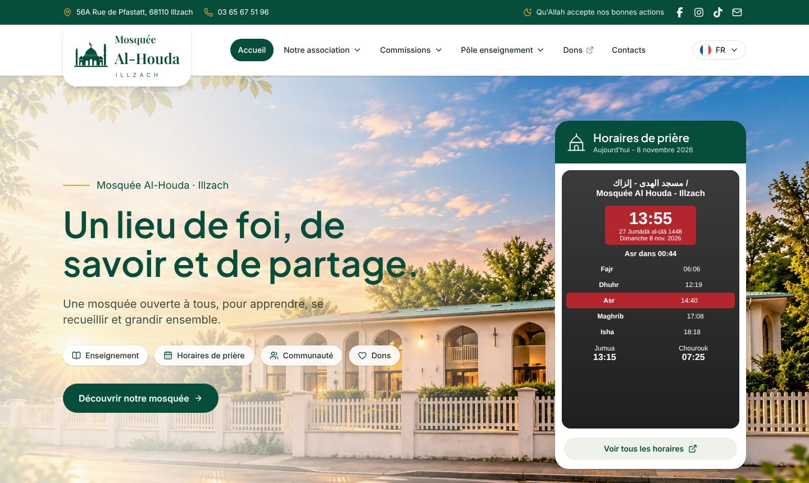
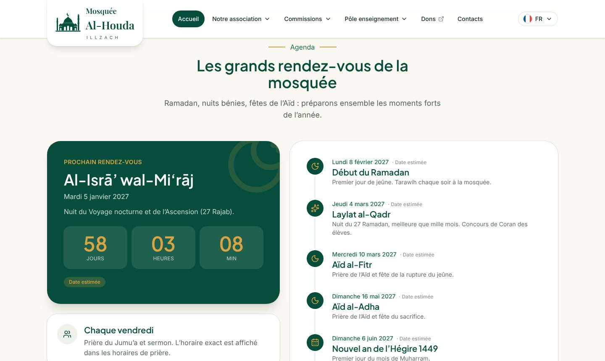
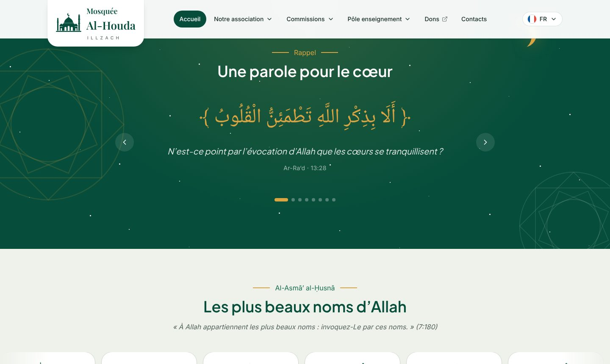
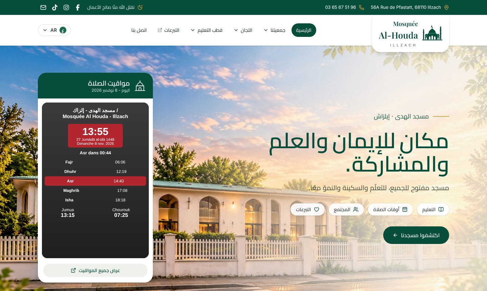
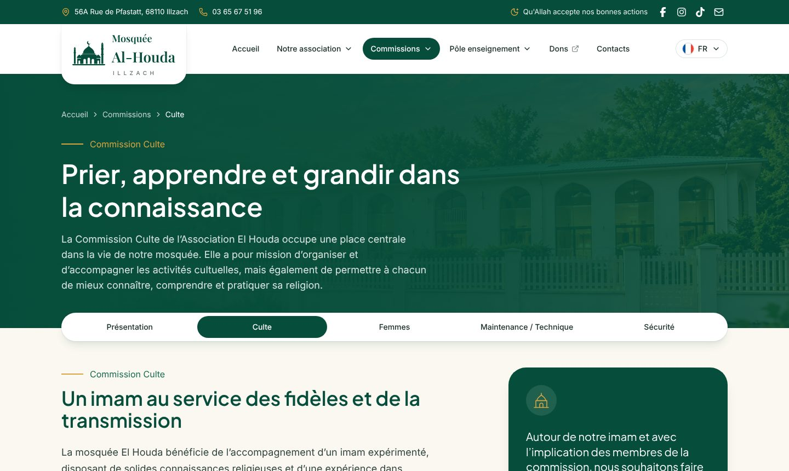
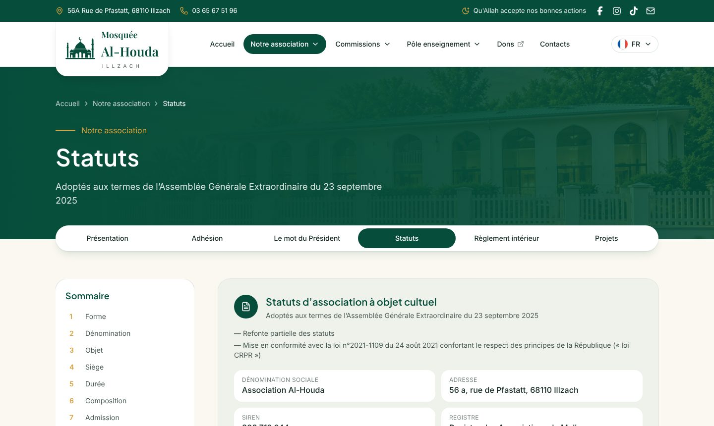
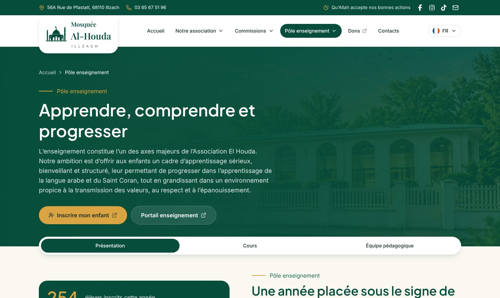
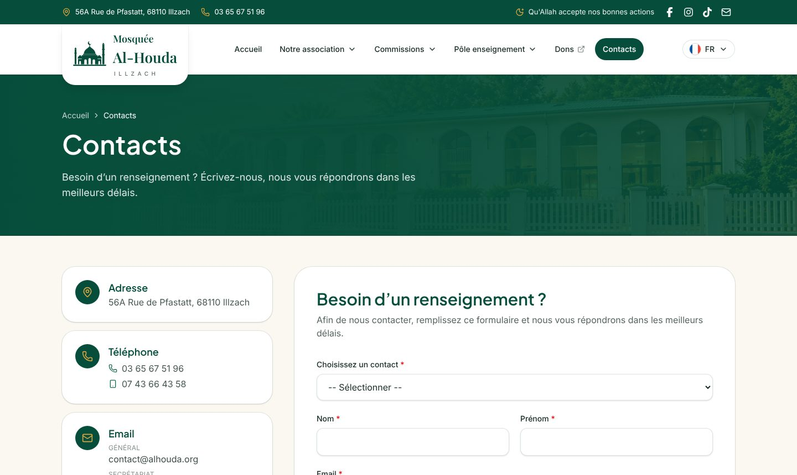
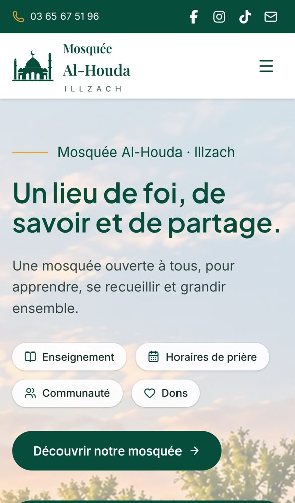

<div align="center">

# 🕌 Mosquée Al-Houda · Illzach

**Site officiel de la mosquée et de l'Association Al-Houda d'Illzach**

Un lieu de foi, de savoir et de partage, en **4 langues** : français · العربية · English · Deutsch




</div>

---

## Sommaire

- [Aperçu](#aperçu)
- [Fonctionnalités](#fonctionnalités)
- [Stack et services](#stack-et-services)
- [Démarrage rapide](#démarrage-rapide)
- [Docker](#docker)
- [Mise en ligne](#mise-en-ligne)
- [Où modifier quoi](#où-modifier-quoi)
- [Langues](#langues)
- [Formulaire de contact](#formulaire-de-contact)
- [Structure du projet](#structure-du-projet)
- [Qualité du code](#qualité-du-code)
- [Avant la mise en ligne](#avant-la-mise-en-ligne)

---

## Aperçu

| Agenda et compte à rebours | Rappel du jour |
|---|---|
|  |  |

| Version arabe (de droite à gauche) | Commission Culte |
|---|---|
|  |  |

| Statuts de l'association | Pôle enseignement |
|---|---|
|  |  |

| Contacts | Mobile |
|---|---|
|  |  |

> Sur les captures, l'encadré des horaires de prière est une reproduction : en vrai, c'est le widget **Mawaqit** de la mosquée qui s'affiche.

---

## Fonctionnalités

**Accueil**
- 🕐 **Horaires de prière en direct** : widget Mawaqit de la mosquée. Les horaires sont gérés par la mosquée dans Mawaqit, rien à mettre à jour sur le site.
- 📅 **Agenda** : prochain grand rendez-vous avec un **compte à rebours** (Ramadan, Laylat al-Qadr, Aïd…), frise des dates suivantes et lien vers les annonces Mawaqit.
- 🌙 **« Une parole pour le cœur »** : versets du Coran qui défilent sur un ciel de nuit animé (étoiles, croissant, étoile à 8 branches).
- ✨ **Les plus beaux noms d'Allah** : deux rangées de noms qui défilent avec leur sens dans chaque langue.
- Les animations s'arrêtent si le visiteur a désactivé les animations sur son appareil.

**Rubriques** (même menu que l'ancien site alhouda.org)

| Menu | Pages |
|---|---|
| Notre association | Présentation · Adhésion · Le mot du Président · Statuts · Règlement intérieur · Projets |
| Commissions | Présentation · Culte · Femmes · Maintenance / Technique · Sécurité |
| Pôle enseignement | Présentation · Cours · Équipe pédagogique · Inscription (Google Form) · Portail (RosarioSIS) |
| Dons | HelloAsso |
| Contacts | Coordonnées, plan, formulaire envoyé directement au bon destinataire |

**Technique**
- Site **100 % statique** : pas de serveur, pas de base de données, pas d'espace d'administration. Hébergement gratuit possible.
- **4 langues** avec une vraie mise en page de droite à gauche pour l'arabe.
- Responsive : téléphone, tablette, ordinateur.

---

## Stack et services

| Outil | Rôle |
|---|---|
| [Next.js 16](https://nextjs.org) (App Router, export statique) | Génère le site en HTML |
| TypeScript · Tailwind CSS 4 | Code et design |
| [next-intl](https://next-intl.dev) | Traductions FR / AR / EN / DE |
| lucide-react · react-icons | Icônes |
| Polices | Plus Jakarta Sans (titres) · Inter (texte) · Cairo et Noto Naskh (arabe) · Playfair Display (logo) |
| Docker + nginx | Développement et production |

| Service externe | Utilisé pour |
|---|---|
| [Mawaqit](https://mawaqit.net) | Horaires de prière et annonces |
| [HelloAsso](https://www.helloasso.com) | Dons et adhésions |
| Google Forms | Inscriptions aux cours d'arabe et de Coran |
| [FormSubmit](https://formsubmit.co) | Envoi du formulaire de contact par e-mail |
| RosarioSIS | Portail de suivi pour les parents |

---

## Démarrage rapide

Prérequis : **Node.js 22** (ou 20.9+) et npm.

```bash
npm install
cp .env.example .env.local   # facultatif en local
npm run dev                  # http://localhost:3000/fr
```

| Commande | Rôle |
|---|---|
| `npm run dev` | Serveur de développement |
| `npm run build` | Génère le site statique dans `out/` |
| `npm run preview` | Aperçu local du dossier `out/` |
| `npm run lint` | ESLint |
| `npm run typecheck` | Vérification TypeScript |
| `npm run i18n:check` | Vérifie que les 4 langues ont les mêmes textes |
| `npm run format` | Formate le code avec Prettier |

---

## Docker

| Commande | Rôle |
|---|---|
| `make up` (`docker compose up -d --build web`) | Développement avec rechargement à chaud → http://localhost:3000/fr |
| `make prod` (`docker compose --profile prod up -d --build site`) | Version de production servie par nginx → http://localhost:8080/fr |
| `make logs` | Logs du serveur de développement |
| `make lint` | Lint, types et traductions |
| `make down` | Arrête tout |

Le `Dockerfile` construit le site avec Node puis le sert avec **nginx** : aucun serveur Node en production.

---

## Mise en ligne

```bash
NEXT_PUBLIC_SITE_URL=https://alhouda.org npm run build
```

Le dossier `out/` contient tout le site. Il se déploie tel quel sur **Cloudflare Pages**, **Netlify**, **GitHub Pages**, un hébergement mutualisé ou l'image Docker nginx.

Sur Cloudflare Pages ou Netlify :
- commande de build : `npm run build`
- dossier de sortie : `out`
- variable : `NEXT_PUBLIC_SITE_URL` = adresse du site

| Variable | Rôle |
|---|---|
| `NEXT_PUBLIC_SITE_URL` | Adresse publique du site (liens entre les langues, métadonnées) |

---

## Où modifier quoi

Aucune compétence en programmation n'est nécessaire pour changer un texte : chaque contenu est dans un fichier clair.

| Je veux changer… | Fichier |
|---|---|
| Adresse, téléphones, e-mails, réseaux sociaux | `src/config/site.ts` |
| Liens HelloAsso, Google Form, RosarioSIS, identifiant Mawaqit | `src/config/site.ts` |
| Destinataires du formulaire de contact | `CONTACT_RECIPIENTS` dans `src/config/site.ts` |
| Menu | `src/config/navigation.ts` |
| **Dates de l'agenda** (à mettre à jour chaque année) | `EVENTS` dans `src/content/home/faith.ts` |
| Versets et noms d'Allah de l'accueil | `VERSES` et `NAMES` dans `src/content/home/faith.ts` |
| Pages Association (présentation, adhésion, mot du Président) | `src/content/association/*.ts` |
| Statuts / Règlement intérieur | `src/content/association/statutes/` et `rules/` (un fichier par langue) |
| Commissions | `src/content/commissions/` |
| Pôle enseignement | `src/content/teaching/overview.ts` |
| Textes de l'interface (boutons, menus, titres) | `messages/fr.json`, `ar.json`, `en.json`, `de.json` |
| Couleurs et animations | `src/app/globals.css` |
| Polices | `src/lib/fonts.ts` |
| Photos | `public/images/` |

Les fichiers de contenu contiennent les 4 langues côte à côte (`fr`, `en`, `de`, `ar`) : on modifie un texte dans chaque langue au même endroit.

---

## Langues

- Les adresses sont toujours préfixées par la langue : `/fr/…`, `/ar/…`, `/en/…`, `/de/…`. La racine `/` redirige vers `/fr/`.
- Le **français** est la langue de référence. Pour les statuts et le règlement intérieur, les versions traduites affichent une mention : **seule la version française fait foi**.
- Après une modification des fichiers `messages/*.json`, lancez `npm run i18n:check`.

---

## Formulaire de contact

Le visiteur choisit un destinataire (Contact, Enseignement, Présidence, Secrétariat, Imam) et le message est envoyé par **FormSubmit** à l'adresse correspondante, sans serveur.

**Activation, une seule fois par adresse :** envoyer un message de test en choisissant ce contact, puis cliquer sur le lien **« Activate Form »** reçu par e-mail. Avant l'activation, les messages vers cette adresse ne sont pas transmis.

Une adresse laissée vide dans `CONTACT_RECIPIENTS` renvoie vers `contact@`.

---

## Structure du projet

```
al-houda/
├── messages/                 Textes de l'interface (fr, ar, en, de)
├── public/images/            Photos du site
├── scripts/check-messages.mjs  Vérification des traductions
├── src/
│   ├── app/[locale]/         Pages (une route par page, pour chaque langue)
│   ├── components/
│   │   ├── home/             Accueil : hero, horaires, agenda, rappels, noms d'Allah
│   │   ├── layout/           En-tête, pied de page, logo, menu mobile, langues
│   │   ├── page/             En-têtes de page, sous-menus, documents juridiques
│   │   └── …                 Association, commissions, enseignement, contact, UI
│   ├── config/               Coordonnées, liens, menu
│   ├── content/              Textes des pages, dans les 4 langues
│   ├── i18n/                 Configuration des langues
│   └── lib/                  Polices, utilitaires
├── Dockerfile · docker-compose.yml · nginx.conf · Makefile
└── next.config.ts            Export statique
```

---

## Qualité du code

Avant chaque commit :

```bash
npm run lint && npm run typecheck && npm run i18n:check
```

Workflow Git : `main` protégée, branches courtes `feature/*`, commits conventionnels (`feat:`, `fix:`, `chore:`).

---

## Avant la mise en ligne

- [ ] Faire relire les traductions **arabe** et **allemande**, en priorité les statuts et le règlement.
- [ ] Faire vérifier le texte arabe des versets par l'imam.
- [ ] Activer FormSubmit pour chaque adresse de contact.
- [ ] Renseigner les e-mails **Enseignement** et **Présidence** dans `src/config/site.ts`.
- [ ] Ajouter une page **Mentions légales** (obligatoire pour un site d'association).
- [ ] Mettre à jour les dates de l'agenda chaque année dans `src/content/home/faith.ts`.

---

<div align="center">

*Mosquée Al-Houda · 56A Rue de Pfastatt, 68110 Illzach*

</div>
